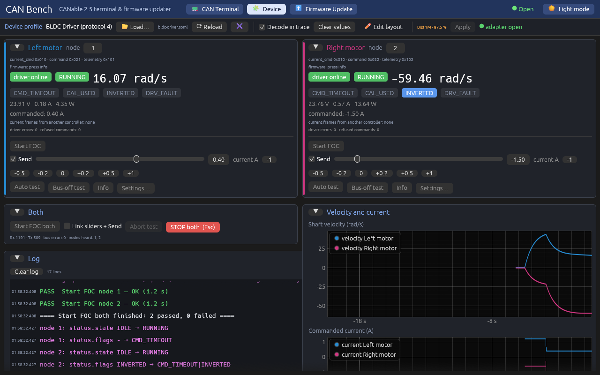
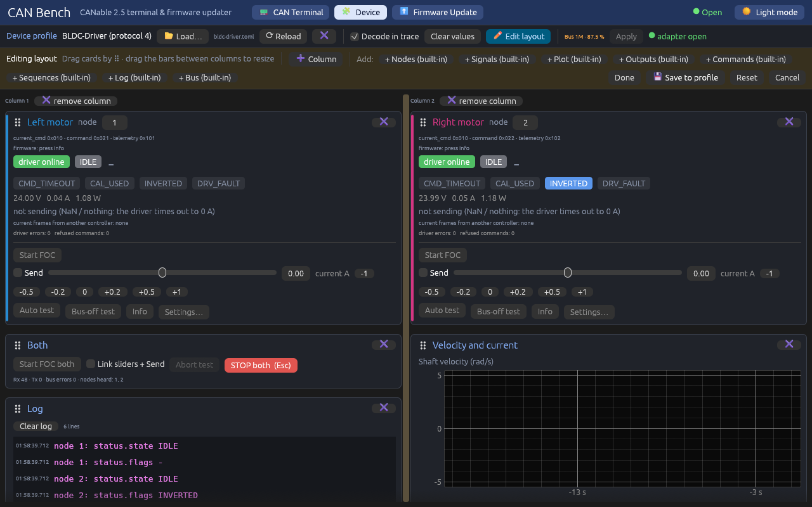
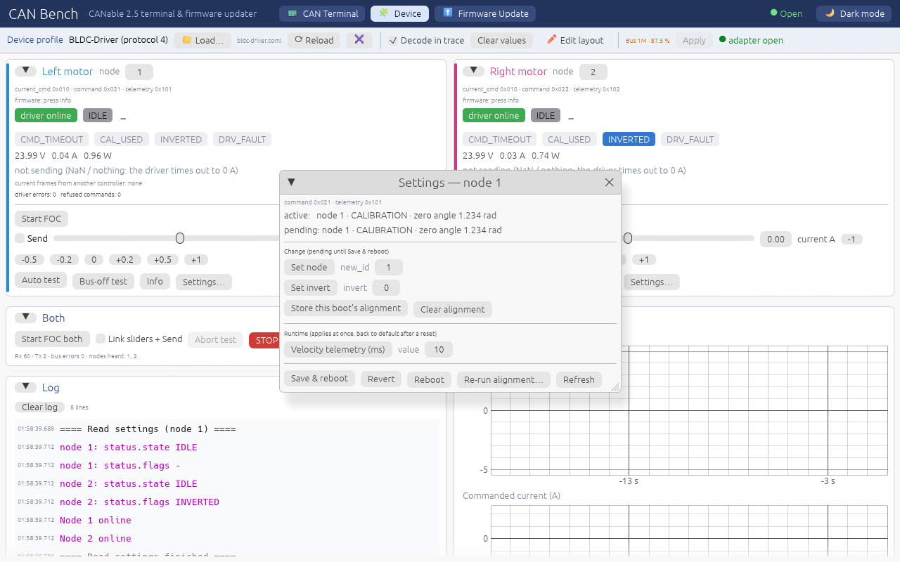
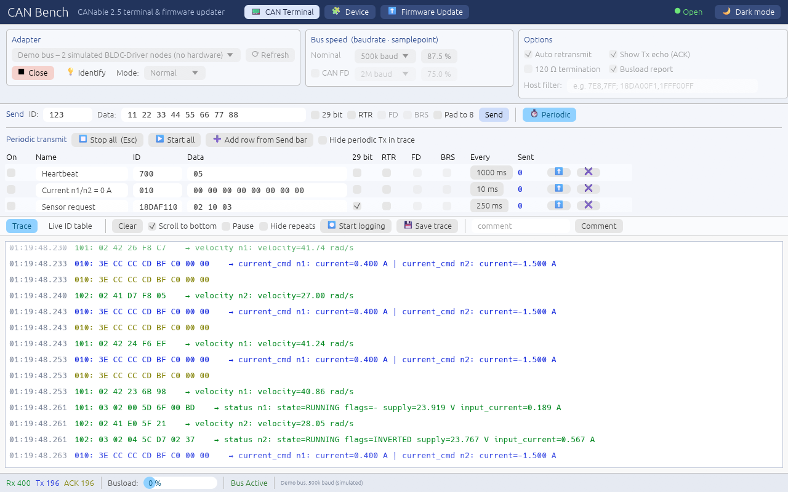
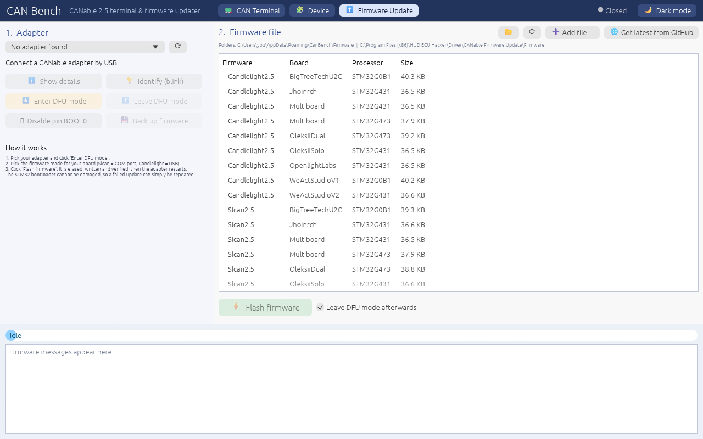

# CAN Bench

**A fast, native CAN bus terminal, device dashboard and firmware updater for
[CANable 2.5](https://github.com/Elmue/CANable-2.5-firmware-Slcan-and-Candlelight) adapters —
built for robotics and embedded development.** Windows, Linux and macOS. Written in Rust.



<sub>The Device page driving two <a href="https://github.com/clawntl/BLDC-Driver">BLDC-Driver</a>
motor controllers (here the built-in simulator, `--demo`): a card per motor, STOP, live velocity and
current plots and an event log with test results — the whole page, its buttons and its test scripts
come from one <a href="profiles/bldc-driver.toml">TOML file</a>.</sub>

## Features

**CAN terminal**
- Works with both CANable 2.5 firmwares: **Candlelight** (USB) and **Slcan** (serial port)
- Classic CAN and **CAN FD**, any baudrate, automatic bit timing for the sample point you want
- Normal, silent (sniff), internal and external loopback modes; software 120 Ω termination on boards that have it
- Colour-coded trace with ACK echo, live ID table with periods, busload, decoded bus errors
- Host-side ID filters, logging to file, comments, raw Slcan commands

**Periodic transmit**
- A saved list of frames, each with its own interval — timed in the adapter thread, so it keeps
  running while the window is minimised
- **Esc stops everything**

**Device page — your own dashboard, no code**
- Describe your protocol in a [device profile](profiles/README.md): messages and signals with
  node-numbered IDs (`0x100 + n`), command-byte multiplexing, several nodes in one frame,
  big/little-endian integers and floats, enums, flags, bit fields, text and computed values
- Build the page from **cards and widgets**: status badges, flag chips, big readouts, sliders with
  presets that are sent periodically, command buttons that wait for the reply, scrolling plots,
  frame-rate and gap monitors, a log — one card per node with `instances`, popup windows for settings
- **Drag and drop** cards between columns, resize columns, hide and add cards — and save the layout
  back into the profile
- **Sequences**: test scripts ([Rhai](https://rhai.rs)) that send commands, drive outputs, measure,
  ask the operator and report **PASS/FAIL** — also from the command line for a test station
  (`--sequence "Auto test" --exit`, exit code 0/1)
- Safety built in: **Esc / STOP** stops every output with its stop value and aborts the running
  test; nothing restarts on its own; a warning when another node sends the same commands

**Firmware updater**
- Download the latest CANable 2.5 firmware from GitHub and flash it over USB DFU, with verify
- Enter/leave DFU mode from the app, back up the current firmware, disable a floating BOOT0 pin

<table>
<tr>
<td width="50%"></td>
<td width="50%"></td>
</tr>
<tr>
<td align="center"><sub>Edit layout: drag cards, resize columns, save to the profile</sub></td>
<td align="center"><sub>A popup card (board settings) for the motor it was opened from</sub></td>
</tr>
<tr>
<td width="50%"></td>
<td width="50%"></td>
</tr>
<tr>
<td align="center"><sub>CAN Terminal: periodic list and a decoded trace</sub></td>
<td align="center"><sub>Firmware Update</sub></td>
</tr>
</table>

## Quick start

1. Download CAN Bench for your system from the
   **[Releases](https://github.com/clawntl/can-bench/releases)** page.
   (Linux: install the [udev rules](packaging/linux/99-can-bench.rules). macOS: right-click → Open the first time.)
2. Plug in your CANable, pick the baudrate, click **▶ Open**.
3. For your own protocol, write a [device profile](profiles/README.md) and load it on the **Device** page.

**No adapter at hand?** Run `can-bench --demo`, open the *Demo bus*, and load
[`profiles/bldc-driver.toml`](profiles/bldc-driver.toml) on the Device page.

## Documentation

| | |
|---|---|
| 📘 [User guide](docs/user-guide.md) | Every page and option, drivers per platform, troubleshooting |
| 🧩 [Device profile reference](profiles/README.md) | Messages, signals, cards, widgets, layout, sequences and every script function, with recipes |
| 🛠 [Development notes](docs/development.md) | Code layout, threads, tests, screenshots, releases |
| 🔌 [Adapter protocol notes](app/MECHANICS.md) | Candlelight/Slcan/DFU details the adapter code relies on |

## A device profile, briefly

```toml
[nodes]
range = [1, 15]
heartbeat = "telemetry.status"

[[message]]
name = "telemetry"
id = "0x100 + n"                  # one ID per node
mux = { byte = 0 }                # byte 0 says what the frame is
  [[message.variant]]
  mux = 0x03
  name = "status"
  signals = [
    { name = "state",  byte = 1, type = "u8", enum = { 1 = "IDLE", 2 = "RUNNING", 3 = "FAULT" }, alarm = ["FAULT"] },
    { name = "supply", byte = 3, type = "u16be", scale = 0.001, unit = "V" },
  ]

[[card]]                          # one card per node
node_select = true
instances = [{ title = "Left", node = 1, color = "#268bd2" }, { title = "Right", node = 2, color = "#d33682" }]
widgets = [
  { type = "row", widgets = [
    { type = "online" },
    { type = "badge", signal = "status.state", colors = { RUNNING = "green", FAULT = "red" } },
    { type = "value", signal = "status.supply", large = true, stale_ms = 500 },
  ] },
  { type = "plot", series = [{ signal = "status.supply" }], seconds = 30 },
]
```

The trace then reads `101: 03 02 00 5D 6F …  ⇒ status n1: state=RUNNING supply=23.919 V`, and the
Device page shows a card per node with a live badge, a big voltage readout and a plot. The
[full BLDC-Driver profile](profiles/bldc-driver.toml) adds sliders, commands, a settings window and
the Auto test and Bus-off test scripts.

## Platform support

| | Windows 10/11 | Linux (x64) | macOS 11+ (Apple Silicon, Intel) |
|---|---|---|---|
| Candlelight (USB) | ✔ WinUSB driver | ✔ udev rule; kernel `gs_usb` is detached while open | ✔ no driver |
| Slcan (serial) | ✔ | ✔ `/dev/ttyACM*` | ✔ `/dev/cu.usbmodem*` |
| Firmware update | ✔ | ✔ | ✔ |

All four builds are compiled and unit-tested on every push by
[GitHub Actions](.github/workflows/build.yml). The Linux and macOS builds have not been tested with real adapters yet — reports welcome.

## Building from source

```sh
cd app
cargo run --release
```

Requires a recent stable Rust. On Linux also install
`pkg-config libudev-dev libxkbcommon-dev libwayland-dev libxcb-render0-dev libxcb-shape0-dev libxcb-xfixes0-dev libgl1-mesa-dev`.
Releases are made by pushing a `v*` tag — see [development notes](docs/development.md#releases).

## Credits

- CANable 2.5 firmware and its protocol: [ElmüSoft](https://github.com/Elmue/CANable-2.5-firmware-Slcan-and-Candlelight)
- GUI: [egui / eframe](https://github.com/emilk/egui) and [egui_plot](https://github.com/emilk/egui_plot); USB: [nusb](https://github.com/kevinmehall/nusb); scripting: [Rhai](https://rhai.rs)
