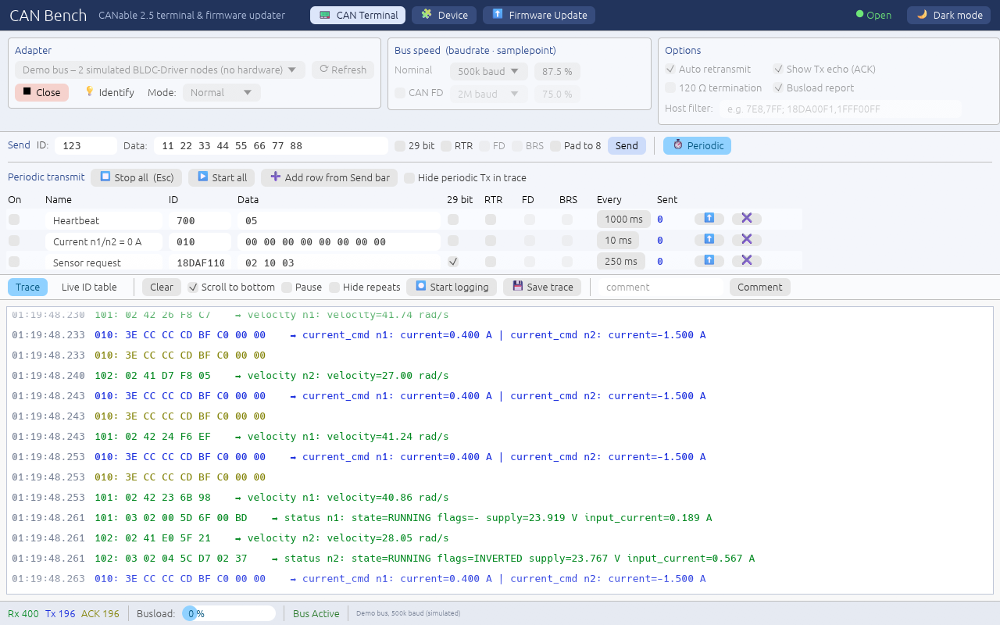
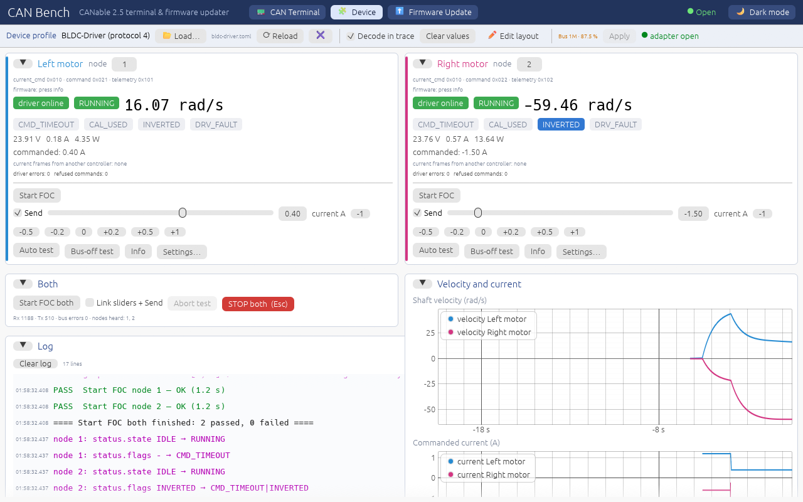
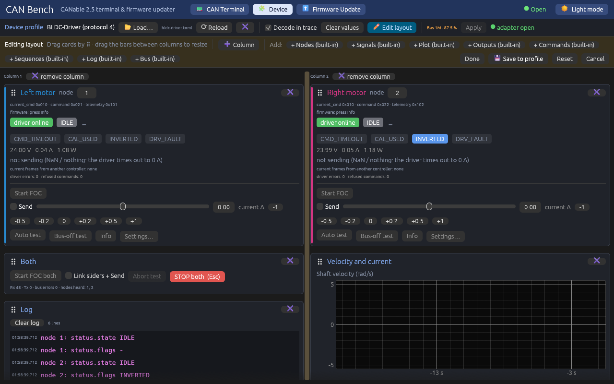
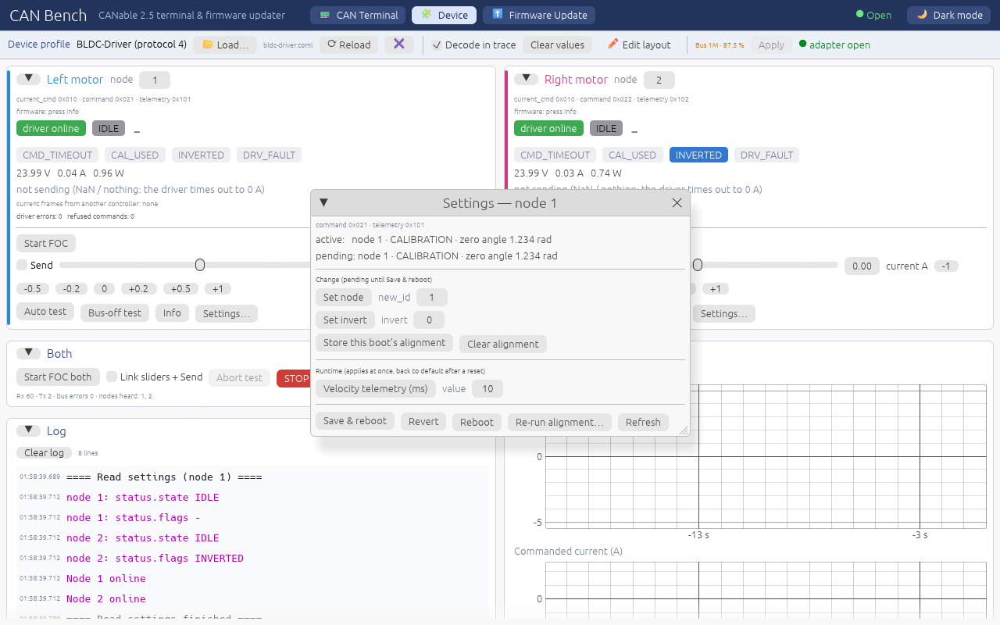
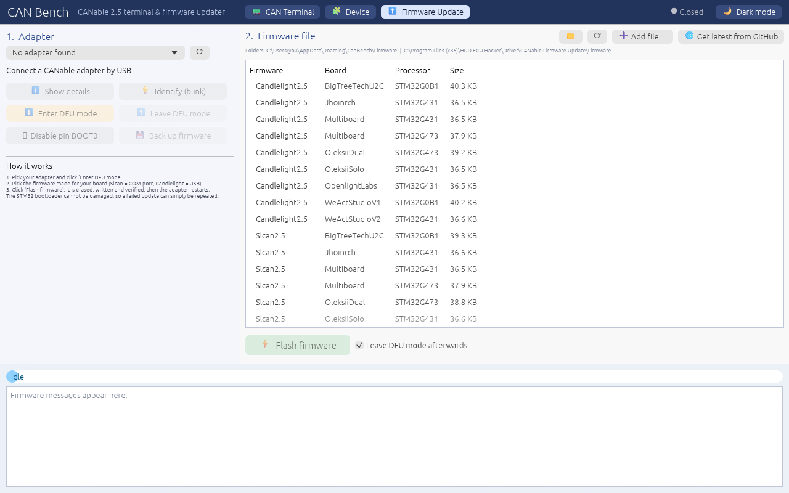

# CAN Bench user guide

- [Installing](#installing)
- [Connecting an adapter](#connecting-an-adapter)
- [CAN Terminal page](#can-terminal-page)
- [Periodic transmit](#periodic-transmit)
- [Device page](#device-page)
- [Firmware Update page](#firmware-update-page)
- [Keyboard and command line](#keyboard-and-command-line)
- [Where files are stored](#where-files-are-stored)
- [Troubleshooting](#troubleshooting)

---

## Installing

Download the file for your system from the [Releases](https://github.com/clawntl/can-bench/releases) page and unpack it.

| System | File | First start |
|---|---|---|
| Windows | `can-bench-…-windows-x64.zip` | Run `can-bench.exe` |
| Linux | `can-bench-…-linux-x64.tar.gz` | Install the udev rules (below), then run `./can-bench` |
| macOS (Apple Silicon / Intel) | `can-bench-…-macos-arm64.zip` / `…-macos-x64.zip` | The app is not notarised: right-click **CAN Bench.app → Open** the first time |

### Drivers and permissions

| | Candlelight firmware | Slcan firmware | Firmware update (DFU) |
|---|---|---|---|
| **Windows** | WinUSB (installed by the CANable firmware updater or [Zadig](https://zadig.akeo.ie)) | COM port, no driver | WinUSB for `0483:DF11` |
| **Linux** | udev rule. CAN Bench detaches the kernel `gs_usb` driver while it has the adapter open | `/dev/ttyACM*`: udev rule, or be in the `dialout` group | udev rule |
| **macOS** | none | `/dev/cu.usbmodem*` | none |

Linux udev rules (from the download, or [`packaging/linux/99-can-bench.rules`](../packaging/linux/99-can-bench.rules)):

```sh
sudo cp 99-can-bench.rules /etc/udev/rules.d/
sudo udevadm control --reload && sudo udevadm trigger
# then unplug and replug the adapter
```

## Connecting an adapter

1. Plug in the CANable 2.5 adapter and click **⟳ Refresh** if it is not listed.
2. Set the **nominal baudrate and sample point** (for CAN FD also the data rate). CAN Bench calculates
   the bit timing for the adapter's clock; if the exact sample point is not possible it tells you
   what it uses.
3. Choose the **mode**: *Normal*, *Silent* (listen only, no ACK — safe for sniffing a running bus),
   *Loopback internal* (no bus needed) or *Loopback external*.
4. Click **▶ Open**. The adapter's details (board, firmware, timing) appear in purple in the trace.

Settings are locked while the adapter is open; close it to change them.

## CAN Terminal page



**Trace colours:** blue = sent, green = received, olive = sent and acknowledged by another node
(echo), purple = adapter information, orange/red = warnings and bus errors.

- **Decoded frames.** With a [device profile](#device-page) loaded, frames are followed by
  `⇒ message n: signal=value …`. Turn this off with *Decode in trace* on the Device page.
- **Live ID table** shows one row per ID with the latest data, count and measured period.
- **Hide repeats** shows each identical frame only once. **Pause** freezes the trace (counters keep running).
- **Start logging** writes everything to a text file as it happens; **Save trace** saves what is on screen.
- **Comment** inserts a marker line, handy for "motor started here" notes in a log.
- **Host filter**: up to 8 `ID,mask` pairs; the adapter then only passes matching IDs to the PC.
- **Slcan command** (Slcan adapters only): send raw Slcan text commands.

**Sending:** type the ID in hex (3 digits = 11-bit, more = 29-bit) and the data bytes, then **Send** or Enter.

## Periodic transmit

Click **⏱ Periodic** in the Send bar to open the list.

- **➕ Add row from Send bar** copies the current ID/data/flags into a new row.
- Tick **On** to start a row. Each row has its own interval (1 ms – 60 s) and counts what it sent.
- **⬆** copies a row back into the Send bar; **✖** deletes it.
- **Esc stops every row** (and every Device output), wherever you are in the window.
- Timing runs in the adapter thread, not in the window, so it keeps going while CAN Bench is minimised.
  With Slcan adapters expect a few ms of jitter, with Candlelight about 1 ms.
- The list is saved automatically. Rows always start **off** after CAN Bench restarts.

## Device page



The Device page is built from a **device profile** — a `.toml` file describing your protocol and
the page itself (see the [profile reference](../profiles/README.md)). Load one with **📂 Load…**;
CAN Bench remembers it. **⟳ Reload** re-reads the file after you edit it. **Apply** next to the bus
settings copies the profile's bitrate to the CAN Terminal page (while the adapter is closed).

The page is a set of **cards** in columns. What a card shows depends on the profile — the BLDC-Driver
example has one card per motor (node chosen in the card's title), a "Both" card with STOP, a plot
card and a log. Typical pieces:

- **Status** — online/offline, state badges, flag chips, large readouts, values that turn grey when
  they stop arriving and red when they are in alarm.
- **Sliders** — tick **Send** to transmit the value every period; presets set it with one click.
  Unticking Send, **STOP** or **Esc** sends the profile's stop value once (for example 0 A).
  *Link* makes all cards' sliders move together.
- **Buttons** — commands (their argument boxes sit next to them; replies, refusals and timeouts go to
  the log), **sequences** (scripted tests, e.g. *Auto test*, with PASS/FAIL lines and a summary),
  and windows such as *Settings…*. Buttons that need it ask before acting.
- **Plots** — scrolling plots of chosen signals, one colour per card.
- **Log** — command replies, test results, state changes the profile marks with `log_changes`, and
  nodes going offline/online.
- **Bus** — frame counters, bus errors, nodes heard, the running sequence, and a warning when another
  node sends the same ID as your output (two controllers fighting).

Collapse a card with ▼. Without cards in the profile you get the built-in cards: Nodes, Outputs,
Commands, Sequences, Signals (tick values to plot them), Plot (with CSV export) and Log.

### Arranging the page



Click **✏ Edit layout**. Drag cards by **⠿** to another place or column, drag the bars between columns
to change their widths, add or remove columns, hide cards with **✖** and bring hidden or built-in
cards back from **Add**. **💾 Save to profile** writes the arrangement into the profile's `[layout]`
section (the rest of the file is kept); **Done** keeps it for this session; **Cancel** undoes.

### Sequences

A sequence runs as a script in the background; the header shows **⏳ name** and an **Abort** button.
**Esc**, **STOP** and **Abort** end it, and an aborted sequence always stops every output. A sequence can
ask you something (*OK / Cancel*), wait for you to do something ("unplug the CAN cable now…"), and
change the node of the card it was started from (e.g. after you renumber a board).

**No hardware?** Start CAN Bench with `--demo`: the adapter list gets a *Demo bus* with two simulated
BLDC-Driver boards. Open it and load `profiles/bldc-driver.toml` — everything above works, including
the Auto test.



## Firmware Update page



1. **Adapter:** pick the adapter and click **Enter DFU mode**. (Already in DFU mode, e.g. booted with
   the BOOT button? It is listed as *STM32 bootloader*.)
2. **Firmware file:** click **Get latest from GitHub**, or **➕ Add file…** for a `.dfu`/`.bin`.
   Files that match your adapter's board are marked ✔. Slcan = COM port, Candlelight = USB.
3. Click **⚡ Flash firmware**. The flash is erased, written and verified, then the adapter restarts.

The STM32 ROM bootloader cannot be overwritten, so a failed update can simply be repeated.
**Back up firmware** reads the current flash into a file first, if you want to be able to go back.
**Disable pin BOOT0** stops boards with a floating BOOT0 pin from starting in DFU mode by themselves.

## Keyboard and command line

| Key | Action |
|---|---|
| **Esc** | Stop all periodic rows, Device outputs (they send their stop values) and the running sequence |
| **Enter** | In the Send bar / Slcan box / Comment box: send |

| Option | Meaning |
|---|---|
| `--demo` | Add the simulated *Demo bus* adapter |
| `--profile FILE` | Load a device profile at start |
| `--open` | Open the selected adapter at start |
| `--sequence NAME [--node N]` | Run a sequence as soon as the adapter is open (node: default the first card's) |
| `--exit` | With `--sequence`: print the results and quit; exit code 0 = all checks passed, 1 = failed or aborted. Handy for a test station: `can-bench --profile p.toml --open --sequence "Auto test" --node 1 --exit` |
| `--device`, `--firmware`, `--periodic` | Start on the Device page / Firmware page / with the periodic list open |
| `--dark` | Dark colours for this run |
| `--edit-layout`, `--popup TITLE` | Start in Edit layout mode / with a popup card open (used for these screenshots) |
| `--screenshot FILE [--shot-delay MS]` | Save a screenshot after MS milliseconds and quit |
| `--autopilot` | Scripted demo session (with `--demo --profile profiles/bldc-driver.toml --open`) |

On Windows CAN Bench is a windowed program, so PowerShell neither waits for it nor shows its output.
For a test station, start it like this to wait, capture the report and get the exit code:

```powershell
$p = Start-Process .\can-bench.exe -ArgumentList '--profile','bldc-driver.toml','--open','--sequence','Auto test','--node','1','--exit' -Wait -PassThru -RedirectStandardOutput result.txt
$p.ExitCode
```

## Where files are stored

| | Folder |
|---|---|
| Windows | `%APPDATA%\CanBench` |
| macOS | `~/Library/Application Support/CanBench` |
| Linux | `$XDG_DATA_HOME/CanBench` or `~/.local/share/CanBench` |

It holds `Firmware/` (downloaded and added firmware files), `periodic.json` (the periodic list),
`profile.txt` (the last device profile) and `theme.txt`. The Device page layout is stored in the
profile itself when you save it.

## Troubleshooting

| Problem | Try |
|---|---|
| Adapter not listed | Click ⟳ Refresh. Windows: Candlelight needs the WinUSB driver. Linux: install the udev rules and replug. |
| "Cannot claim the adapter" | Another program (or another CAN Bench window) has it open. On Linux, check nothing else uses `can0`. |
| Frames are sent but never acknowledged (no olive echo) | No other node on the bus, wrong baudrate, missing 120 Ω termination, or the adapter is in Silent mode. |
| "Bus off" / error passive | Wrong baudrate or sample point, missing termination, CAN-H/CAN-L swapped. |
| Profile does not load | The red message names the message, signal and field. Unknown keys are errors — check spelling. |
| A sequence says "Open the adapter…" | Sequences need the adapter open on the CAN Terminal page. |
| A node shows *missing* | Its heartbeat message did not arrive within `timeout_ms`; check `[nodes].heartbeat` names the right message. |
| Periodic frames stall | The adapter's Tx buffer is full: no node is acknowledging, or the bus is overloaded (see Busload). |
